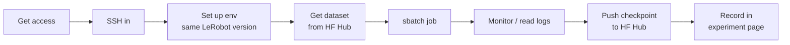

# NCSA Delta GPU Training Guide

Maintainers: Adam Hammoud, Karim Joumaa · Last verified: [TEAM VERIFICATION REQUIRED]

How we train LeRobot policies on [NCSA Delta](https://docs.ncsa.illinois.edu/systems/delta/), NCSA's GPU cluster. Follow these pages in order the first time.

!!! danger "Site-specific: check the current Delta docs"
    Hostnames, partitions, paths, modules, and limits are set by NCSA and change over time. Check everything marked `[TEAM VERIFICATION REQUIRED]` against the [Delta documentation](https://docs.ncsa.illinois.edu/systems/delta/).

!!! warning "No secrets anywhere on this site"
    Never write passwords, tokens, private keys, or allocation credentials here. Say *who* manages access, not what the access is.

## The workflow

## Pages

| # | Page | Covers |
|---|---|---|
| 1 | [Access & SSH](access.md) | Allocation, accounts, logging in, SSH config |
| 2 | [Storage](storage.md) | Where to put what, quotas, purge policy |
| 3 | [Environment](environment.md) | Modules, Python env, installing LeRobot |
| 4 | [Moving Data](data-transfer.md) | Getting datasets onto Delta |
| 5 | [Submitting Jobs](jobs.md) | sbatch, requesting GPUs |
| 6 | [SLURM Job Template](slurm-template.md) | Our version-controlled job script |
| 7 | [Monitoring & Failed Jobs](monitoring.md) | Job status, logs, fixing failures |
| 8 | [Checkpoints & Reproducibility](checkpoints-reproduce.md) | Getting results back, re-running a past run |

## Our allocation at a glance

| Item | Ours |
|---|---|
| Allocation program | [TEAM VERIFICATION REQUIRED]: e.g. ACCESS or an Illinois allocation |
| Allocation manager / PI | [TEAM VERIFICATION REQUIRED]: who adds new users |
| Expires | [TEAM VERIFICATION REQUIRED] |
| GPU hours remaining (check regularly) | [TEAM VERIFICATION REQUIRED]: how to check |
