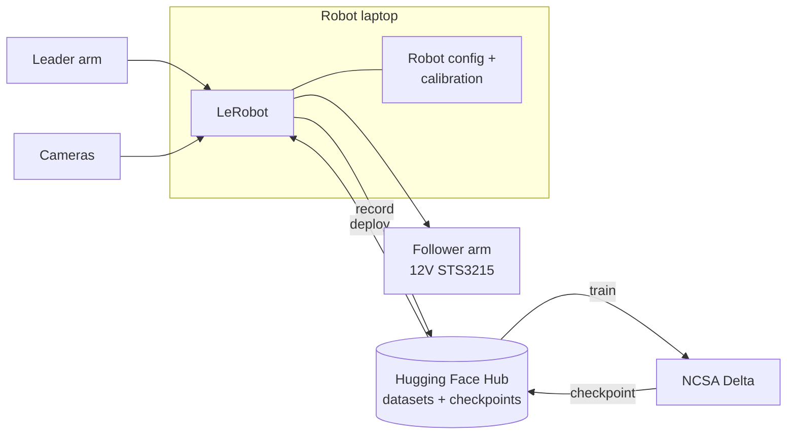

# Handoff for Future Teams

Maintainer: whole team · Last updated: [TEAM VERIFICATION REQUIRED] · Update before the end of every semester

If you're the next team: welcome. This section is everything we wish we'd known on day one.

## Start here

1. Read [Current State](current-state.md) to see what works and what doesn't.
2. Work through [Access Transfer](access-transfer.md) with the outgoing team **before they graduate**.
3. Get your own setup running with [Reproducing the Setup](reproduce.md).
4. Check [Inventory & Locations](inventory.md) for hardware, datasets, and models.
5. Plan your semester with [Next Steps](next-steps.md).

## One-paragraph summary

`[TEAM VERIFICATION REQUIRED]: 3–4 sentences at the end of the semester. What we built, where it stands, and the single most important thing to do next.`

## Architecture in one picture

Details: [Hardware](../hardware/index.md) · [Software & ML](../software/index.md) · [NCSA Delta](../delta/index.md)
