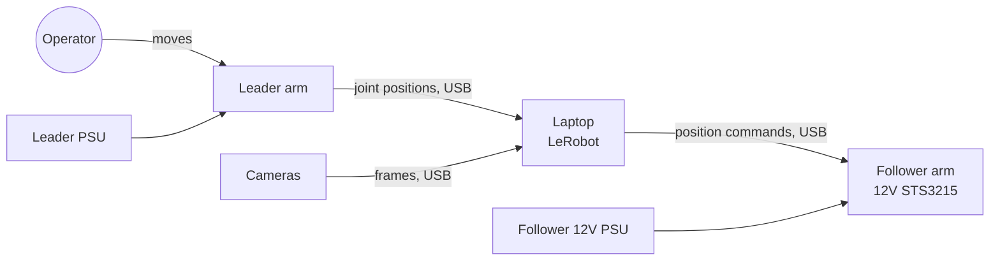

# Hardware Overview

Maintainers: Era Shkembi, Tristan Elizalde · Last verified: [TEAM VERIFICATION REQUIRED]

## The SO-101 system

The SO-101 is an open-source, low-cost arm design with six servos (five arm joints plus a gripper) from [TheRobotStudio](https://github.com/TheRobotStudio/SO-ARM100). LeRobot supports it directly. We use **two arms**:

- **Leader arm.** A person moves it by hand. Its servos act as position sensors.
- **Follower arm.** It copies the leader during teleoperation, and runs learned policies on its own later.

We **3D printed all structural parts ourselves**; we didn't buy a kit. Print details: [3D-Printed Components](printed-parts.md).

## Leader vs follower

The two arms look alike but are configured differently. The full comparison is on [Leader & Follower Architecture](leader-follower.md). The short version: the **follower uses 12V STS3215 servos**, and the two arms must never share a power supply unless the voltages are confirmed to match.

## System diagram

[ADD REAL PHOTO]: both arms on the bench, labeled.

## Pages in this section

| Page | What's there |
|---|---|
| [Leader & Follower Architecture](leader-follower.md) | How the two arms differ and how they work together |
| [Bill of Materials](bom.md) | Every part, quantity, supplier, cost |
| [Mechanical Assembly](assembly.md) | Build notes beyond the official guide |
| [3D-Printed Components](printed-parts.md) | STL sources, print settings, reprint notes |
| [Servo Configuration](servos.md) | STS3215 specs, IDs, settings |
| [Power Distribution](power.md) | Supplies, voltages, current |
| [Wiring Diagrams](wiring.md) | Annotated wiring for each arm |
| [Calibration](calibration.md) | What calibration does, where files live, when to redo it |
| [Hardware Safety](safety.md) | Hazards, emergency stop, rules |
| [Maintenance & Replacement](maintenance.md) | Inspection, swapping parts, maintenance log |

## External references

- [SO-ARM100 / SO-101 hardware repo](https://github.com/TheRobotStudio/SO-ARM100)
- [LeRobot SO-101 guide](https://huggingface.co/docs/lerobot/so101)
- [XLeRobot docs](https://xlerobot.readthedocs.io/), our main build guide
