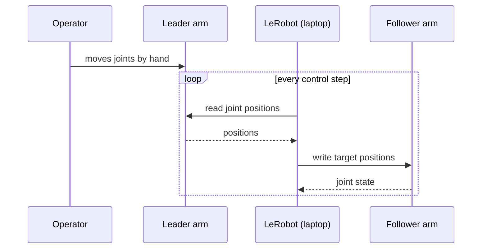

# Leader & Follower Architecture

Maintainers: Era Shkembi, Tristan Elizalde · Last verified: [TEAM VERIFICATION REQUIRED]

## How the pair works

During **teleoperation**, a person moves the leader arm by hand. LeRobot reads the leader's joint positions and sends them as targets to the follower, which copies the motion. Those recorded demonstrations become training data. During **autonomous runs**, the leader isn't used at all: a trained policy sends targets to the follower instead.

## Configuration comparison

| | Leader | Follower |
|---|---|---|
| Role | Human input device | Does the task |
| Servo model | [TEAM VERIFICATION REQUIRED] | Feetech **STS3215, 12V version** |
| Servo variants per joint | [TEAM VERIFICATION REQUIRED: the official SO-101 BOM lists the leader configuration] | [TEAM VERIFICATION REQUIRED] |
| Supply voltage | [TEAM VERIFICATION REQUIRED] | 12V ([details](power.md)) |
| Controller board | [TEAM VERIFICATION REQUIRED] | [TEAM VERIFICATION REQUIRED] |
| Gripper end | [TEAM VERIFICATION REQUIRED: handle/trigger] | Gripper jaw |
| Torque during teleop | [TEAM VERIFICATION REQUIRED: is it disabled so it moves freely?] | Enabled |
| Software ID | [TEAM VERIFICATION REQUIRED] | [TEAM VERIFICATION REQUIRED] |

!!! danger "Don't mix them up"
    Label every part, cable, and supply. Setup procedure: [Quickstart step 5](../quickstart/05-leader-follower.md).

[ADD REAL PHOTO]: leader and follower side by side, with the differences labeled.
