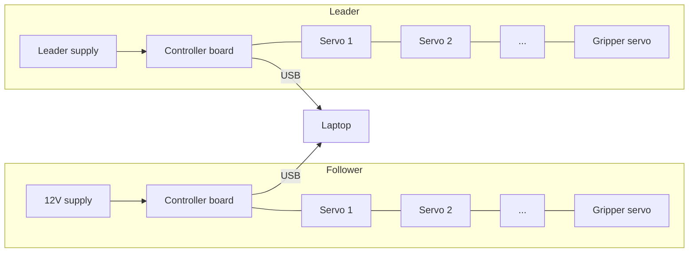

# Wiring Diagrams

Maintainers: Era Shkembi, Tristan Elizalde · Last verified: [TEAM VERIFICATION REQUIRED]

## Overview

The chain order above is generic. Replace it with our real order once it's confirmed. `[TEAM VERIFICATION REQUIRED]`

## Follower arm

[ADD REAL DIAGRAM] Annotated photo: board model, power input and polarity, USB, servo chain order and IDs

## Leader arm

[ADD REAL DIAGRAM] Same as above for the leader

## Connector reference

| Connection | Connector type | Notes |
|---|---|---|
| Servo to servo | [TEAM VERIFICATION REQUIRED] | |
| Board power input | [TEAM VERIFICATION REQUIRED] | Polarity: [TEAM VERIFICATION REQUIRED] |
| Board to laptop | [TEAM VERIFICATION REQUIRED] | Must be a data-capable cable |

Store editable diagram source files in `docs/assets/diagrams/`.
