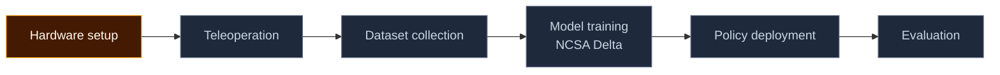

---
hide:
  - navigation
  - toc
---

# Generalist Robotics

SO-101 · Hugging Face LeRobot · NCSA Delta

We're working toward a generalist manipulation pipeline on low-cost SO-101 robot arms: leader–follower teleoperation for collecting demonstrations, learned policies trained on GPU clusters, and real-world evaluation. This site documents how everything is built, what has actually worked, and what went wrong, so the next team can start where we stopped.

[Start the Quickstart :material-arrow-right:](quickstart/index.md){ .md-button .md-button--primary }
[Hardware](hardware/index.md){ .md-button }
[Software & ML](software/index.md){ .md-button }
[Handoff](handoff/index.md){ .md-button }

## Project status

| Item | Details |
|---|---|
| **Course** | Senior Design 1 (CIS) — University of Michigan–Dearborn |
| **Semester** | Fall 2026 |
| **Phase** | Robot arms only: get the SO-101 arms moving and doing simple tasks autonomously |
| **Status** | In progress |
| **Project client** | Dr. Ang Li, UM-Dearborn CIS `[TEAM VERIFICATION REQUIRED: confirm title / role wording]` |
| **Team** | Era Shkembi · Tristan Elizalde · Adam Hammoud · Karim Joumaa ([roles](team/index.md)) |
| **Last site update** | 2026-11-07 |
| **Code** | [GitHub repository](https://github.com/eshkembi18/UMD-Robotics) `[TEAM VERIFICATION REQUIRED]` |

## Pipeline

Colors show where each stage stands. Update the `class` lines below as stages move.

Implemented &nbsp; In progress &nbsp; Planned &nbsp; Validated with recorded results

| Stage | Status | Where it's documented |
|---|---|---|
| Hardware setup (3D-printed SO-101, servos, wiring) | In progress | [Hardware](hardware/index.md), [Quickstart 1–5](quickstart/index.md) |
| Teleoperation (leader → follower) | Planned `[TEAM VERIFICATION REQUIRED]` | [Quickstart 8](quickstart/08-teleoperation.md) |
| Dataset collection | Planned | [Dataset Collection](software/dataset-collection.md) |
| Model training on NCSA Delta | Planned | [NCSA Delta guide](delta/index.md) |
| Policy deployment | Planned | [Inference & Deployment](software/inference-deployment.md) |
| Evaluation | Planned | [Experiments](experiments/index.md) |

## Demo

[ADD REAL VIDEO] 
Embed a short clip of the arm working once you have one. 
Host it on YouTube (unlisted) or Hugging Face, not in git.

## Where to go

-   :material-rocket-launch: **[Quickstart](quickstart/index.md)**

    Parts on a table to a moving arm, step by step.

-   :material-cog: **[Hardware](hardware/index.md)**

    BOM, printing, leader vs follower, servos, wiring.

-   :material-brain: **[Software & ML](software/index.md)**

    Architecture, environment, data, training, deployment.

-   :material-server: **[NCSA Delta](delta/index.md)**

    Getting GPU training running on the cluster.

-   :material-flask: **[Experiments](experiments/index.md)**

    What we tested, how, and the recorded results.

-   :material-wrench: **[Troubleshooting](troubleshooting/index.md)**

    Symptom → cause → fix for every problem we hit.

-   :material-scale-balance: **[Decision Log](decisions/index.md)**

    Why we chose what we chose.

-   :material-account-switch: **[Handoff](handoff/index.md)**

    For next semester's team: what works, what's next, who has access.

