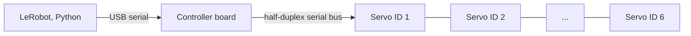

# Communication with Hardware

<p class="gr-meta">Maintainers: Adam Hammoud, Karim Joumaa · Last verified: [TEAM VERIFICATION REQUIRED] · LeRobot: [TEAM VERIFICATION REQUIRED]</p>

## The path from Python to a servo



LeRobot talks to the controller board over a USB serial port. The board relays packets onto the servo bus, and each servo only answers packets addressed to its own ID. That's why every ID on an arm has to be unique.

| Item | Value |
|---|---|
| Protocol | Feetech serial bus protocol |
| Baud rate | [TEAM VERIFICATION REQUIRED] |
| How ports appear | [TEAM VERIFICATION REQUIRED]: e.g. `/dev/ttyACM*` (Linux), `/dev/tty.usbmodem*` (macOS), `COM*` (Windows). Confirm what we saw |
| Linux permissions | [TEAM VERIFICATION REQUIRED]: what we did (group membership or udev rule) |

## Checking communication

```bash
# [INSERT VERIFIED COMMAND]: scan the bus / read positions from each ID
```

**Expected:** every ID on the arm responds. [TEAM VERIFICATION REQUIRED]: paste real output

## Common problems

See [Troubleshooting → Servo communication](../troubleshooting/servo-communication.md).
